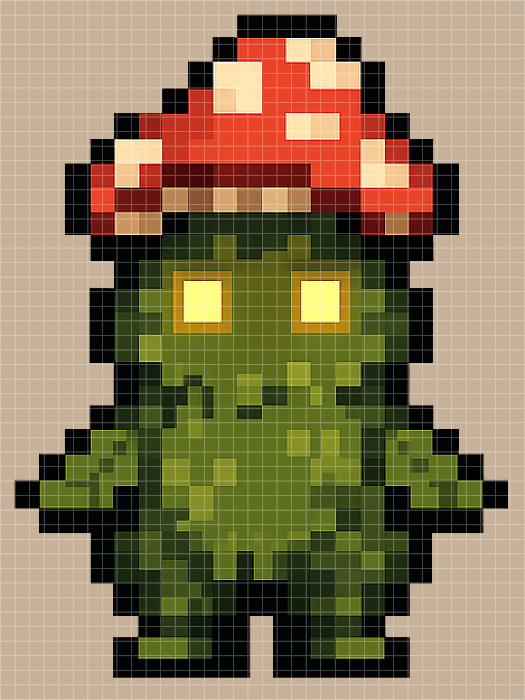
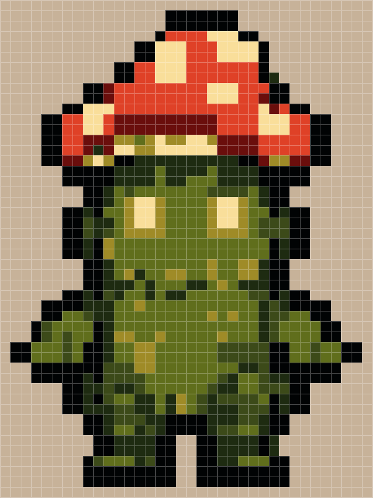
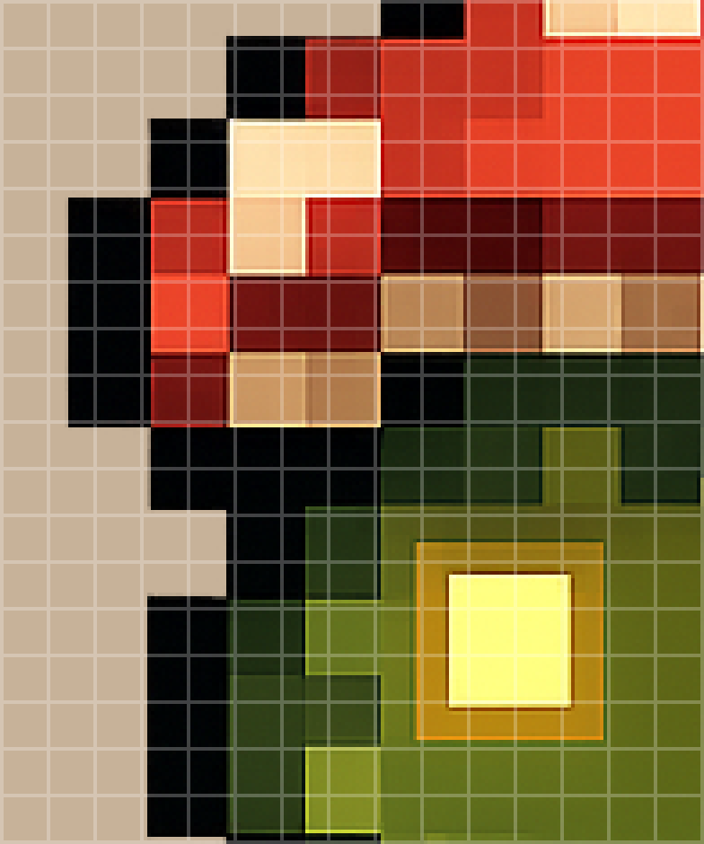
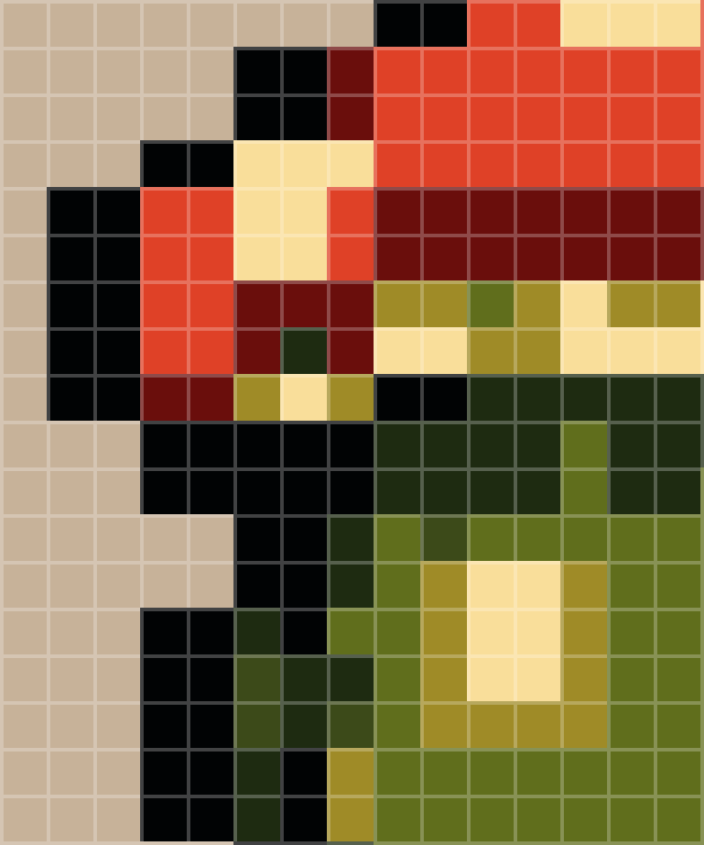
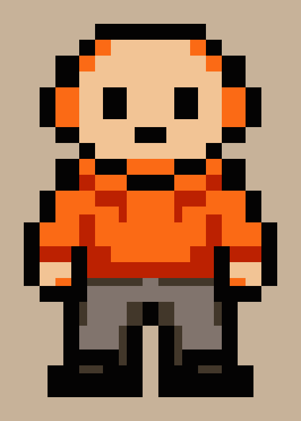
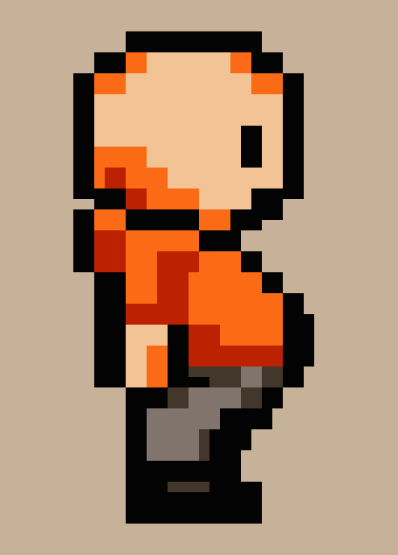
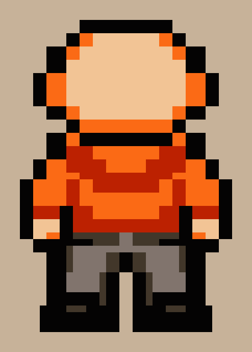

# Pixel Perfect

AI could generate pixel art assets, however what it produces only *looks* like pixel art, without being true pixel art. The core idea behind this project was to take AI-generated pixel art and turn it into true pixel art, by sampling the colour of each block, quantising the palette, and reconstructing it on a clean grid. In this way, it 'snaps' the pixels into place.

(These days, AI is more advanced, such that generating true pixel art will be of no difficulty anyway.)

## Example Results

The same grid laid over an AI-generated sprite (left) and its reconstruction (right). The AI pixels drift across the grid lines, whereas every cell of the reconstruction is a single colour:

<p align="center">
  
  
</p>

Zooming in (before on left, after on right): 

<p align="center">
  
  
</p>

## Usage

1. Install dependencies with `pip install -r requirements.txt`.
2. Add pixel art to `inputs/`
    - To use a separate colour palette for each image, add images to the folder: `inputs/individual/`
    - To use a shared colour palette across multiple images, add all images to a folder: `inputs/<set_name>/`
3. Run from the repo root with chosen block size and number of colours:

```bash
python pipeline.py --folder {folder name} --block_size 13 --num_colours 8
```

Each run processes both the set folder and `inputs/individual/`. Sets are saved to `outputs/<set_name>/` and individual images to `outputs/individual/`. To also save every intermediate image (cropped, grid overlay, reconstructed, canvas), uncomment the `save_debug_outputs` call in `pipeline_image`.

Block size is currently found by eye - run with a guess, check the grid overlay, and adjust. The CLI flags are there to make that loop quick without editing `config.py`.


## Pipeline Stages

Each stage of the pipeline is a module in `stages/`, orchestrated by `pipeline.py`.

1. `find_bounds.py` - Crops the sprite to the tightest box around visible pixels, so the grid starts flush with its edges.

2. `sample_blocks.py` - Loops through each block of the cropped image and samples one representative colour (the centre pixel by default). Outputs an array with one RGBA colour per block.

3. `quantise_colours.py` - Groups the block colours into a palette of `num_colours` with k-means, then snaps each block to its nearest palette colour.

4. `construct_blocks.py` - Paints each quantised colour back out as a full block, to rebuild the sprite on a clean grid.

5. `place_on_canvas.py` - Scales the sprite by a whole-number factor and centres it on a 1080x1350 background.

6. `watermark_image.py` - Adds embossed text to the bottom-right corner of the canvas.

7. `save_outputs.py` - Saves the final canvas to `outputs/`, and optionally every intermediate image for debugging.

`draw_grid.py` is an optional stage that overlays the block grid on any image, used for visual alignment to see what block size fits best.


## Key Design Considerations

### Sampling Strategy

Each block is reduced to a single colour by sampling the most central pixel in the block. Multiple sample functions were compared, and taking the centre pixel was chosen. One of the biggest challenges was the spectrum of colours at the edges due to anti-aliasing which would cause a lot of noise in the results. The centre worked best since it was further from these noisy pixels, and was simple, while being equally as good as the complex alternative (palette proximity).

### Colour Quantisation

K-means clustering with `num_colours` centroids was used to condense the sampled colours into the specific pure colours. What looks like a single colour in original images was actually constituted of hundreds of slightly different shades. 

### Shared Palette Across Related Images

Multiple views of the same character should use exactly the same colours across all images, and therefore quantisation can be applied using the combined sample of colours for images in a folder in `inputs/`.

<p align="center">
  
  
  
</p>

### Hard Pixel Edges When Scaling

- Whole-number scale factor, so every block becomes the same number of canvas pixels (a fractional scale leaves some blocks a pixel wider)
- Nearest-neighbour resizing, so no new colours are interpolated and block edges stay sharp

## Known Limitations

### Manual Block Size

Block size is current found by eye using the grid overlay as an intermediate step. This was hard to automate reliably since the 'pixels' in the AI art would vary. Variance and Fast Fourier Transform approaches were attempted, but with no reliable verification. It felt overengineered to continue pursuing this automation step. 

### Transparent Background

The pipeline replies on a transparent background, with a certain threshold of alpha in rgba. If an image has an opage background, that background is considered as part of the image - with quantisation etc. 

## Tech Stack

Python, Pillow, NumPy, pydantic, aggdraw
