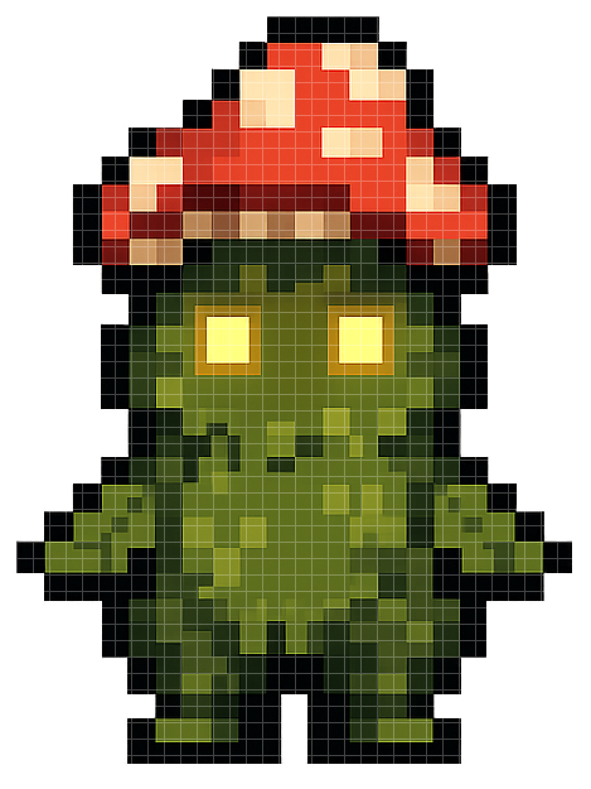
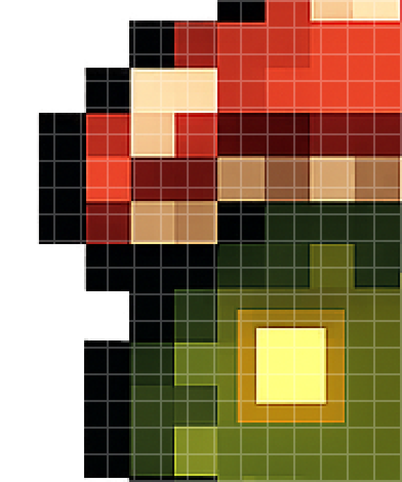

# pixel-grid-pipeline

AI could generate pixel art assets, however what it would produces only *looks* like pixel art, without being true pixel art. The core idea behind this project was to take AI-generated pixel art and turn it into true pixel art, by sampling the colour of each block, quantising the palette, and reconstructing it on a clean grid. In this way, it 'snaps' the pixels into place.

(These days, AI is more advanced, such that generating true pixel art will be of no difficulty anyway.)

## Exaple Results

The same grid laid over an AI-generated sprite (left) and its reconstruction (right). The AI pixels drift across the grid lines, whereas every cell of the reconstruction is a single colour:

An AI generated sprite on the left, and its reconstruction on the right, with the same grid overlay:

<p align="center">
  
  
</p>

Zooming in: 

<p align="center">
  
  
</p>

## Usage

1. Install dependencies with `pip install -r requirements.txt`.
2. Add pixel art sprite to `inputs/`
    - Standalone sprites go in `inputs/individual/` and each get their colour palette
    - Related images to share one colour palette go in their own folder: `inputs/<set_name>/`
3. Set the block size, palette size and set folder in `config.py`, or override in command line.
4. Run from the repo root:

```bash
python pipeline.py                                                              # Processes the configured set folder and inputs/individual/
python pipeline.py --folder {folder name} --block_size 13 --num_colours 8           # Overrides config for one run
```

Sets are saved to `outputs/<set_name>/` and standalone sprites to `outputs/individual/`. To also save every intermediate image (cropped, grid overlay, reconstructed, canvas), uncomment the `save_debug_outputs` call in `pipeline_image`.

Block size is currently found by eye: run with a guess, check the grid overlay, and adjust. The CLI flags are there to make that loop quick without editing `config.py`.


## Pipeline Stages

Each stage of the pipeline is a module in `stages/`, orchestrated by `pipeline.py`.

1. `find_bounds.py`. Crops sprite to the tigest box around visible pexels to make it flush with the edges

2. `sample blocks.py` - Loops through each 'block' of the image and samples more representative colour. Outputs a 3D array representing each block colours of the final construction.

3. `construct_blocks.py` - Paints each quantised colour back out as a full block, such to rebuild the sprite

4. `place_on_canvas.py` - Scales the sprite up to a whole-number factor and centres it on 1080x1350 background

5. `place_on_canvas.py` - Optional, adds embossed text to the final image bottom right corner.

6. `save_outputs.py` - Saves the final canvas to outputs folder.

`draw_grid.py` is an optional stage that overlays the block grid on any image, used for visual alignment to see what block size fits best


## Key Design Considerations

### Sampling Strategyd

### Colour Quantisation 

### Shared Palette Across Related Images

### Hard Pixel Edges When Scaling

## Known Limitations

### Manual Block Size

### Transparent Background

## Tech Stack

Python, Pillow, NumPy, pydantic, aggdraw
